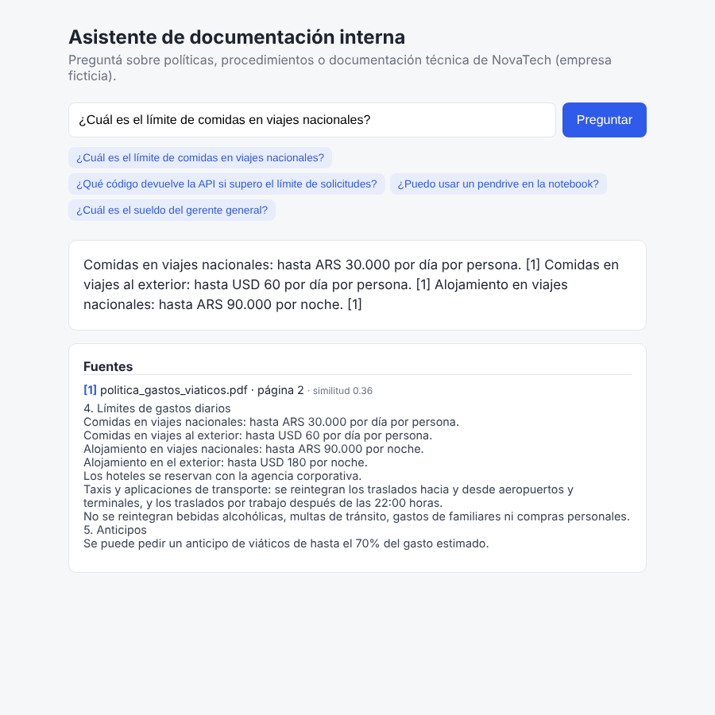

# Enterprise RAG Assistant

Asistente de IA que responde preguntas sobre la documentación interna de una empresa, **citando los documentos de donde sacó la respuesta**. Si la información no está en los documentos, lo dice en vez de inventar.

Para el proyecto armé una empresa ficticia (**NovaTech**) con 9 documentos: políticas de RRHH, procedimientos, un manual técnico de API y un código de conducta, en PDF, TXT y Markdown.



## Qué hace

- Carga documentos **PDF, TXT y Markdown** (también se pueden subir nuevos desde la API).
- Divide los documentos en fragmentos y genera **embeddings**.
- Ante una pregunta, **recupera los fragmentos más relevantes** (búsqueda por similitud coseno).
- **Genera una respuesta con citas** `[1]`, `[2]` y muestra documento, página y fragmento usado.
- **Responde "no tengo información suficiente"** cuando ningún fragmento supera un umbral de similitud o cuando el LLM no encuentra la respuesta en el contexto.
- Expone todo con una **API REST en FastAPI** y una página web simple para probarlo.
- Incluye una **evaluación con 90 preguntas** y **26 tests automáticos**.

## Herramientas

| Herramienta | Para qué la usé |
|---|---|
| Python 3.11+ | Lenguaje principal |
| FastAPI + Pydantic | API REST y validación de datos |
| pypdf | Extraer texto de los PDFs (por página) |
| scikit-learn (TF-IDF) | Embeddings por defecto, sin descargar modelos |
| sentence-transformers *(opcional)* | Embeddings semánticos multilingües |
| NumPy | Vector store propio (matriz de embeddings + similitud coseno) |
| Claude API (Anthropic) | Generar la respuesta a partir de los fragmentos |
| pytest | Tests unitarios, de API y de regresión de calidad |
| GitHub Actions | Corre los tests y la evaluación en cada push |

## Arquitectura

```
                 INDEXACIÓN                                     CONSULTA
 data/docs/ (PDF, TXT, MD)                        Pregunta del usuario (POST /ask)
        │                                                   │
   loader.py   lee el texto (y la página en PDFs)    embeddings.py  vectoriza la pregunta
        │                                                   │
   chunker.py  fragmentos de ~120 palabras          vector_store.py  top-4 por similitud coseno
        │       con 1 oración de overlap                    │
   embeddings.py  vectoriza cada fragmento          ¿score >= 0.20? ── no ──> "No encontré información"
        │                                                   │ sí
   vector_store.py  guarda en storage/ (.npy + .json)  generator.py  Claude responde SOLO con los
                                                            │        fragmentos y cita cada dato [n]
                                                     Respuesta + fuentes (documento, página, score)
```

```
app/
├── main.py           # API FastAPI
├── rag.py            # pipeline: indexar, recuperar, responder
├── loader.py         # lectura de PDF / TXT / MD
├── chunker.py        # división en fragmentos
├── embeddings.py     # TF-IDF o sentence-transformers
├── vector_store.py   # búsqueda por similitud
├── generator.py      # Claude (con prompt anti-alucinación) o modo extractivo
└── static/index.html # demo web
data/docs/            # documentos de la empresa ficticia
eval/                 # preguntas de evaluación, script y resultados
tests/                # tests con pytest
scripts/              # indexar, preguntar por terminal, generar PDFs
```

**Dos modos de generación:**
- **Con `ANTHROPIC_API_KEY`**: Claude redacta la respuesta. El prompt le exige usar solo los fragmentos, citar cada dato y devolver `SIN_INFORMACION` si no encuentra la respuesta.
- **Sin API key**: modo **extractivo**, que devuelve las oraciones de los fragmentos más parecidas a la pregunta. Así el proyecto funciona sin costo y los tests no dependen de servicios externos.

## Instalación

```bash
git clone https://github.com/<tu-usuario>/enterprise-rag-assistant.git
cd enterprise-rag-assistant
python -m venv .venv
source .venv/bin/activate        # Windows: .venv\Scripts\activate
pip install -r requirements.txt

cp .env.example .env             # opcional: agregar ANTHROPIC_API_KEY
python scripts/ingest.py         # indexa los documentos
uvicorn app.main:app --reload
```

- Demo web: http://localhost:8000
- Documentación interactiva de la API (Swagger): http://localhost:8000/docs

## Ejemplos de consultas

**Pregunta con respuesta en los documentos:**

```bash
curl -X POST http://localhost:8000/ask \
  -H "Content-Type: application/json" \
  -d '{"question": "¿Cuál es el límite de comidas en viajes nacionales?"}'
```

```json
{
  "answer": "Comidas en viajes nacionales: hasta ARS 30.000 por día por persona. [1] ...",
  "has_answer": true,
  "sources": [
    {"ref": 1, "document": "politica_gastos_viaticos.pdf", "page": 2, "score": 0.36, "text": "4. Límites de gastos diarios ..."}
  ],
  "generator": "extractive"
}
```

**Pregunta sin respuesta en los documentos:**

```bash
curl -X POST http://localhost:8000/ask -H "Content-Type: application/json" \
  -d '{"question": "¿Cuál es el sueldo del gerente general?"}'
```

```json
{"answer": "No encontré información suficiente en la documentación para responder esa pregunta.", "has_answer": false, "sources": []}
```

**Subir un documento nuevo:**

```bash
curl -X POST http://localhost:8000/documents -F "file=@mi_documento.pdf"
```

**Desde la terminal, sin levantar la API:**

```bash
python scripts/ask.py "¿Qué hago si recibo un correo de phishing?"
```

| Endpoint | Descripción |
|---|---|
| `POST /ask` | Hace una pregunta. Body: `{"question": "...", "top_k": 4}` |
| `GET /documents` | Lista los documentos indexados |
| `POST /documents` | Sube un PDF/TXT/MD y reindexa |
| `POST /reindex` | Vuelve a indexar la carpeta `data/docs` |
| `GET /health` | Estado del servicio |

## Evaluación

Armé un set de **90 preguntas** ([`eval/questions.jsonl`](eval/questions.jsonl)): 77 que se pueden responder con los documentos (con el documento y los datos esperados) y 13 que **no** tienen respuesta (para ver si el sistema inventa).

```bash
python eval/run_eval.py
```

Resultados con la configuración por defecto (TF-IDF + modo extractivo, sin LLM):

| Métrica | Resultado |
|---|---|
| Recuperación Hit@1 (documento correcto en 1er lugar) | **94.8%** |
| Recuperación Hit@4 (documento correcto en el top 4) | **100%** |
| Exactitud (la respuesta contiene el dato esperado) | **87.0%** |
| Abstención correcta (dice "no sé" cuando no hay información) | **84.6%** |
| Abstención incorrecta (dice "no sé" pero sí había información) | **6.5%** |

El detalle de cada error está en [`eval/results.md`](eval/results.md).

**Qué aprendí con la evaluación:**
- La primera versión (TF-IDF por palabras) tenía 74% de exactitud y 77% de abstención correcta. Mejoré la limpieza del texto de los PDFs, saqué los títulos de las respuestas y pasé a **n-gramas de caracteres** (para que "contraseña" y "contraseñas" se parezcan), y llegué a 87% / 85%.
- El **umbral de similitud** es un trade-off: si lo subo, el sistema inventa menos pero se niega a responder preguntas válidas. Elegí 0.20 probando varios valores.
- Los errores que quedan son de **sinónimos** (preguntar "ir a la oficina" cuando el documento dice "asistir"), algo que TF-IDF no entiende. Para eso está la opción de embeddings semánticos (`EMBEDDING_BACKEND=sentence-transformers`) y el modo con Claude, que redacta mejor y filtra preguntas sin respuesta.

## Tests

```bash
pytest -v
```

26 tests que cubren: carga de PDF/TXT/MD, chunking, recuperación del documento correcto, citas en la respuesta, respuesta "sin información", guardar/cargar el índice, endpoints de la API (incluida la subida de archivos y validaciones), el generador de Claude con un cliente simulado, y un **test de regresión** que falla si las métricas de la evaluación bajan de un mínimo.

## Limitaciones y próximos pasos

- Las métricas publicadas son del modo extractivo. Falta correr la evaluación con Claude y con embeddings semánticos para compararlos.
- La exactitud se mide por palabras clave; una mejora sería usar un LLM como evaluador.
- El vector store en NumPy alcanza para pocos miles de fragmentos; con más documentos usaría una base vectorial (Chroma, pgvector).
- Al subir un documento se reindexa todo; se podría indexar solo el archivo nuevo.
- Agregar autenticación a la API y un Dockerfile.

---

Los documentos de NovaTech son ficticios y fueron creados solo para este proyecto.
